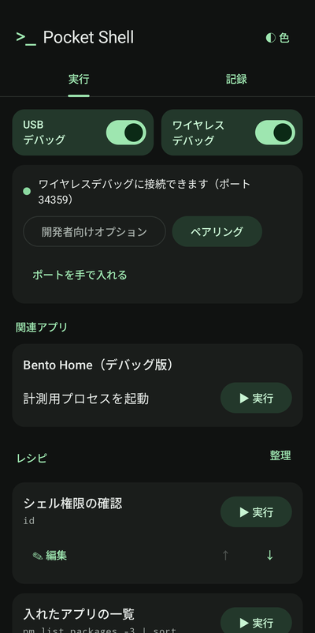
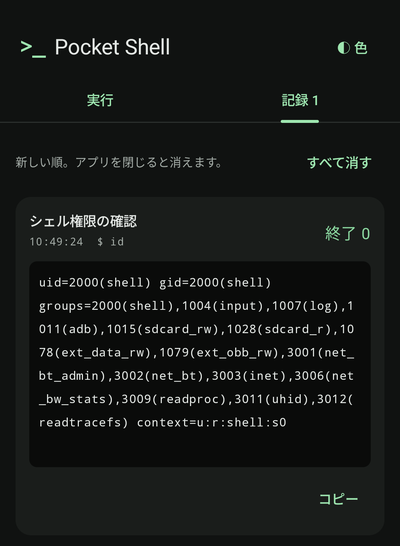
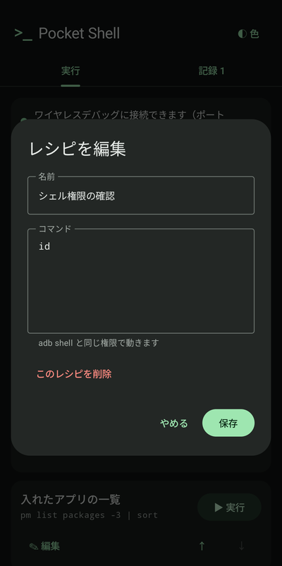
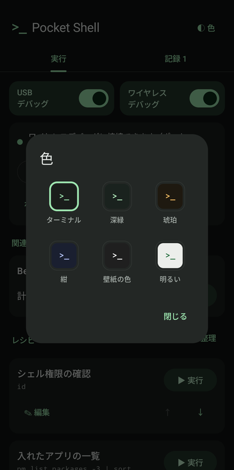

  

<h1 align="center">Pocket Shell</h1>

パソコンなしで、スマホから自分自身に adb のコマンドを送るアプリ

---

Android には、パソコンからスマホを操作するための「adb」という仕組みがあります。権限の付与など、一部の設定は adb のコマンドでしか変えられません。

Pocket Shell は Android の「ワイヤレスデバッグ」を使って、**スマホの中から自分自身に** adb のコマンドを送ります。パソコンもケーブルも要りません。よく使うコマンドは「レシピ」として登録しておけば、ボタン1つで実行できます。

> [!WARNING]
> コマンドは adb と同じ強い権限で動きます。意味の分からないコマンドは実行しないでください。インターネットで見つけたコマンドを貼り付けるときは特に注意してください。

## 画面

<table>
  <tr>
    <td align="center"> 実行</td>
    <td align="center"> 記録</td>
    <td align="center"> レシピの編集</td>
    <td align="center"> 色</td>
  </tr>
</table>

- **実行:** 接続の状態、レシピ、その場で打つコマンドの欄があります。
- **記録:** 実行すると自動でこのタブに移り、結果が出ます。結果は長押しで選ぶか「コピー」で写せます。
- **レシピ:** よく使うコマンドに名前を付けて保存します。並べ替えもできます。その場で打ったコマンドも「レシピにする」で保存できます。「整理」から、最初の例に戻すことも、すべて削除することもできます。
- **色:** 右上の「◐ 色」で、画面の配色を選べます（ターミナル・深緑・琥珀・紺・壁紙の色・明るい）。

## 関連アプリ

一緒に使うと便利なアプリが入っていると、「実行」のタブに「関連アプリ」としてボタンが出ます。入っていなければ何も出ません。

| アプリ | できること |
|---|---|
| [Bento Home](https://github.com/kuronekorou39/bento-home) | システムモニターの計測用プロセスを起動する。スマホを再起動すると止まるので、そのたびにボタンを押せば起動し直せます。 |

## 動作環境

- Android 14 以降
- Wi-Fi につながっていること（ワイヤレスデバッグの条件です）
- 作者の Pixel（Android 17）で確かめています。他の機種では確かめていません。

## 入れ方

Google Play には出していません。APK ファイルを直接インストールします。

1. このページの右側にある「Releases」から、最新の `pocket-shell-….apk` をスマホでダウンロードします。
2. ダウンロードしたファイルを開きます。「提供元不明のアプリ」の許可を求められたら、表示に従って許可します。
3. Play プロテクトやウイルス対策アプリが警告を出すことがあります。ストアを通していないアプリには出る警告です。

## はじめかた

### 1. 開発者向けオプションを出す

1. Android の設定 → デバイス情報 を開きます。
2. 「ビルド番号」を7回続けて押します。「デベロッパーになりました」と出れば完了です。

### 2. ワイヤレスデバッグをオンにする

1. Pocket Shell を開き、「ローカルネットワーク」の許可を求められたら「許可する」を押します。スマホの中のワイヤレスデバッグを探すのに使います。
2. 「開発者向けオプション」を押し、「ワイヤレスデバッグ」をオンにします。

ワイヤレスデバッグは、スマホを再起動するとオフに戻ります。下の「5. 次からボタンでオンにする」をしておくと、Pocket Shell の画面からオンにできます。

### 3. ペアリングする（最初の1回だけ）

1. Pocket Shell の「ペアリング」を押すと、設定が開きます。
2. 「ワイヤレスデバッグ」→「ペア設定コードによるデバイスのペア設定」を開きます。6桁のコードが出ます。
3. コードの画面は**開いたまま**、画面の上から通知欄を下ろします。
4. Pocket Shell の通知の「コードを入力」に、その6桁を入れます。
5. 「ペアリングしました」と出たら完了です。Pocket Shell に戻ります。

### 4. コマンドを実行する

- 「実行」のタブの上が「ワイヤレスデバッグに接続できます」になっていれば準備完了です。
- レシピの「▶ 実行」を押すと実行し、「記録」のタブに結果が出ます。
- 「＋ レシピを追加」で、よく使うコマンドを名前を付けて登録できます。

### 5. 次からボタンでオンにする（任意）

一度つながったら、「実行」のタブの上の「ボタンでオンにできるようにする」を押します。Pocket Shell が自分に、ワイヤレスデバッグを切り替える許可を付けます。

これで、再起動などでオフになっても「ワイヤレスデバッグをオンにする」ボタンでオンにでき、使い終わったら「オフにする」で閉じられます。初めてつなぐ Wi-Fi では、開発者向けオプションから一度オンにしてください。

### つながらないとき

接続が見つからないときは、「ポートを手で入れる」から、ワイヤレスデバッグの画面に出ている「IP アドレスとポート」のコロンの後ろの数字を入れてください。

## プライバシー

- インターネットの権限を持っていますが、つなぐのはスマホの中の adb（127.0.0.1）だけです。外部には通信しません。
- 実行したコマンドと結果は、アプリを閉じると消えます。スマホの中に保存するのは、登録したレシピと、ペアリングに使う鍵だけです。

## 開発者向け

- Kotlin と Jetpack Compose で書いています。
- `./gradlew installDebug` で、つないだスマホにデバッグ版を入れられます（パッケージ名は `com.rou39.pocketshell.debug`）。
- 署名・公開の手順: [docs/operations.md](docs/operations.md)
