# Pocket Shell の使い方

[README](../README.md) の続きです。入れたあと、使えるようになるまでの手順です。赤枠が押す場所です。

## 1. 開発者向けオプションを出す

Android の設定 → デバイス情報 を開き、「ビルド番号」を7回続けて押します。「デベロッパーになりました」と出れば完了です。

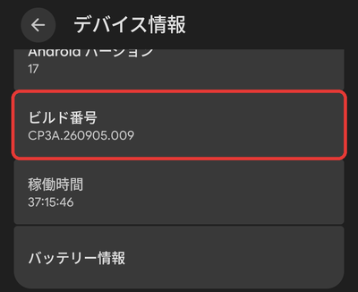

## 2. ワイヤレスデバッグをオンにする

Pocket Shell の「開発者向けオプション」を押し、「ワイヤレス デバッグ」をオンにします。Wi-Fi につながっている必要があります。

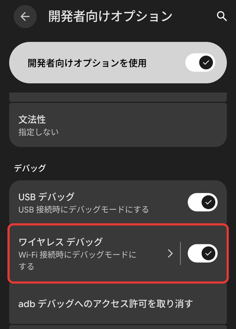

最初に「ローカルネットワーク」の許可を求められたら「許可する」を押してください。スマホの中のワイヤレスデバッグを探すのに使います。

## 3. ペアリングする（最初の1回だけ）

1. Pocket Shell の「ペアリング」を押します。設定が開きます。
2. 「ワイヤレス デバッグ」の画面を開き、「専用コードによるデバイスのペア設定」を押します（Android 16 までは「ペア設定コードによるデバイスのペア設定」）。6桁のコードが出ます。
3. コードの画面は**開いたまま**、画面の上から通知欄を下ろします。Pocket Shell の通知の「コードを入力」を押し、6桁を入れて送ります。

<table>
  <tr>
    <td align="center">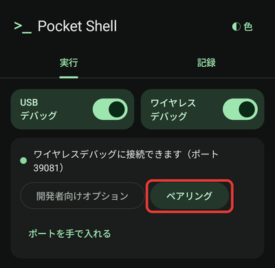 1. ペアリング</td>
    <td align="center">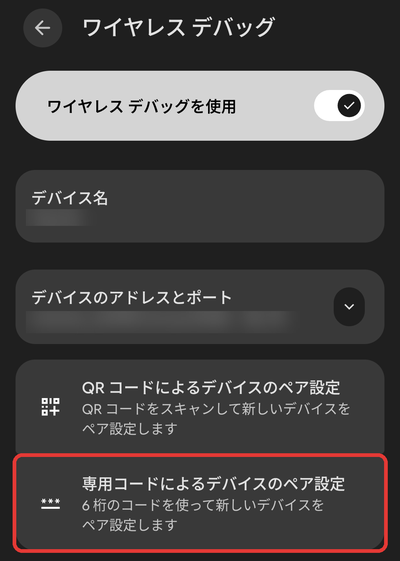 2. コードでペア設定</td>
    <td align="center">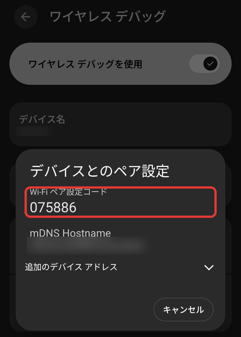 6桁のコード</td>
  </tr>
</table>

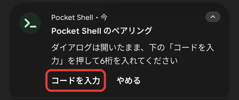 
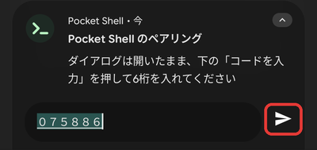

「ペアリングしました」と出たら完了です。すでにペアリング済みのときは失敗しますが、「接続できます」と出ていればそのまま使えます。

## 4. コマンドを実行する

レシピの「▶ 実行」を押すと、「記録」のタブに結果が出ます。

<table>
  <tr>
    <td align="center">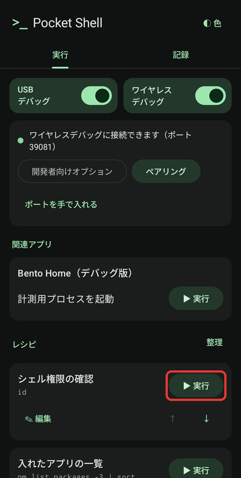 実行</td>
    <td align="center">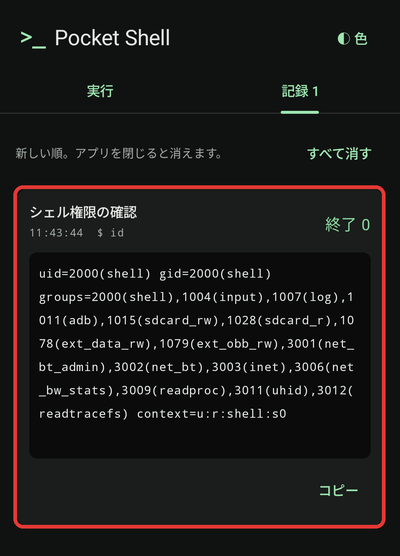 結果</td>
  </tr>
</table>

- 「＋ レシピを追加」で、よく使うコマンドを登録できます。その場で打ったコマンドも「レシピにする」で残せます。
- レシピの「整理」から、最初の例に戻すことも、すべて削除することもできます。

## 5. スイッチで切り替えられるようにする（任意）

一度つながったら「スイッチで切り替えられるようにする」を押します。これで、一番上のスイッチで USB デバッグ・ワイヤレスデバッグを切り替えられます。許可は再起動しても残ります。

<table>
  <tr>
    <td align="center">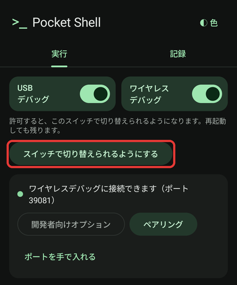 許可を付ける</td>
    <td align="center">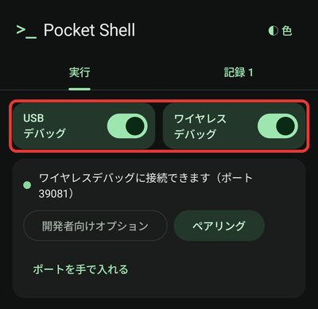 スイッチで切り替え</td>
  </tr>
</table>

- 再起動でワイヤレスデバッグがオフになっても、スイッチでオンにできます。
- 初めてつなぐ Wi-Fi では、開発者向けオプションから一度オンにしてください。
- USB デバッグをオフにすると、パソコンからの adb はつながらなくなります。

## つながらないとき

「ポートを手で入れる」から、ワイヤレスデバッグの画面に出ている「IP アドレスとポート」のコロンの後ろの数字を入れてください。

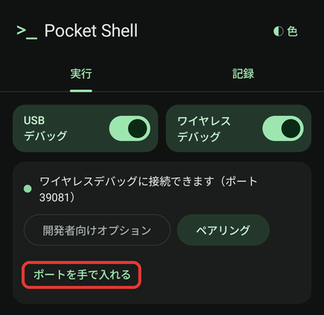

## プライバシー

- インターネットの権限を持っていますが、つなぐのはスマホの中の adb（127.0.0.1）だけです。外部には通信しません。
- 実行したコマンドと結果は、アプリを閉じると消えます。スマホの中に保存するのは、登録したレシピ・色の設定・ペアリングに使う鍵だけです。
